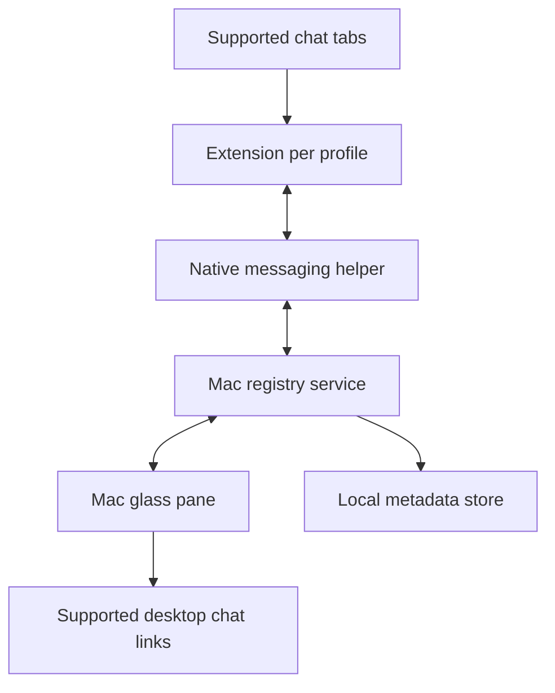
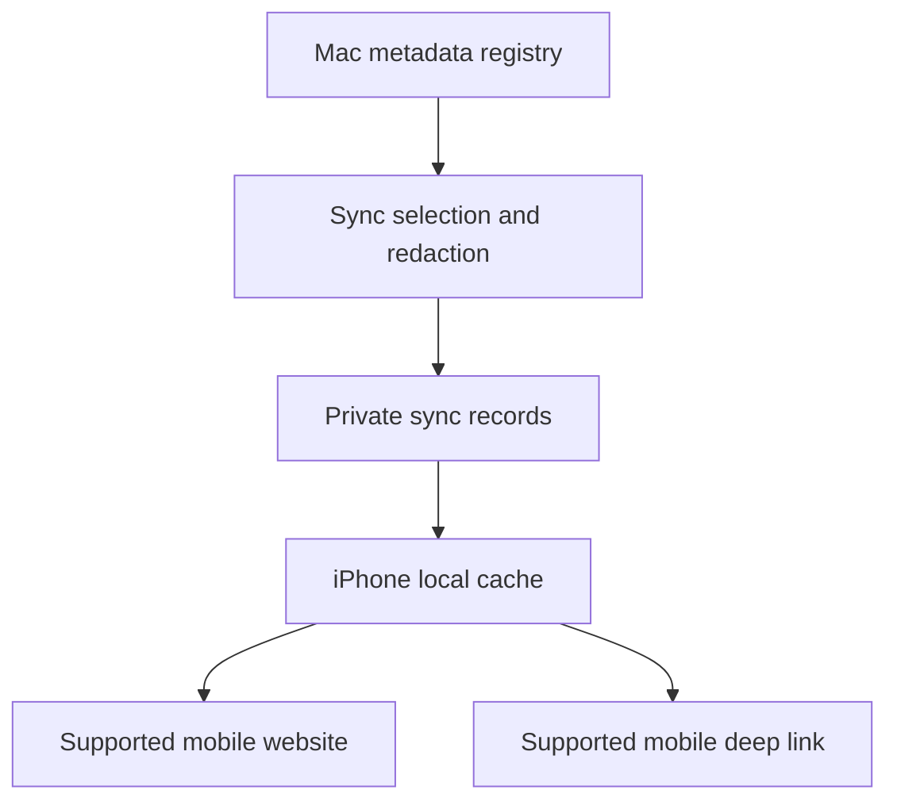

# Component architecture

## Design status

Proposed engineering baseline. ADR-002 covers native/extension choices; ADR-003 covers mobile synchronization. All integrations require the feasibility evidence in PLAN-001.

## Components

| Component | Proposed technology | Responsibility |
| --- | --- | --- |
| Mac UI | SwiftUI hosted in AppKit panel | Edge capsule, pane, shortcuts, settings, accessibility |
| Local registry service | Swift, single writer, SQLite | Destinations, status projection, lifecycle and preferences |
| Native messaging helper | Small signed Swift executable | Browser stdio framing and connection to the local registry service |
| Browser connector | Chrome MV3, TypeScript | Tab inventory, tab/window focus, source-specific page observation |
| Provider adapters | Versioned TypeScript modules | Canonical conversation identity and capabilities; status evidence |
| Shared native package | Swift package | Models, status reducer, destination resolver, sync DTOs |
| iPhone app | SwiftUI | Optional synchronized list, mobile navigation, freshness |
| Sync transport | Proposed CloudKit private database | Selected metadata snapshots and device enrollment; no browser credentials |
| Development memory | Markdown plus Python utility | Project state, decisions, search, handoff; separate from runtime product data |

Native messaging is the browser-to-helper transport. Chrome documents a host process reached by extension service workers; the helper forwards validated events to the local service [S05](SOURCES.md). A signed XPC connection is the proposed helper-to-service transport. Prove packaging, launch lifecycle, sandbox constraints, and signature validation in TASK-011 before committing to a specific service registration mechanism. Do not add a public localhost HTTP listener merely to simplify the prototype.

## Local topology

## Browser connection identity

Each extension installation stores a random connector ID in local extension storage, plus a user-readable alias such as Personal or Work. Do not sync this ID across profiles. Pair it with the Mac installation and record the allowed extension ID. Reconnection gets a new connection epoch; ephemeral tab/window IDs are valid only inside that epoch.

A profile copy may clone storage. Detect simultaneous connections claiming the same ID and require re-enrollment of the duplicate rather than merging their inventories. User aliases are display labels, never authentication proof.

The extension service worker owns tab queries and activation. Content scripts observe only permitted provider origins. Validate sender tab, sender URL, route, and message schema at the service worker. Re-validate at the native boundary. Treat page-provided values as untrusted data.

## Event flow

1. Extension connects with protocol version and supported capabilities.
2. Native service validates the helper/connection identity and acknowledges a new epoch.
3. Extension emits a full inventory snapshot for supported tabs, with a monotonically increasing sequence number within the epoch.
4. Subsequent changes use upsert/remove events. Gaps request a new snapshot rather than guessing missing state.
5. Provider adapters emit normalized status observations with source, observation time and expiry.
6. Registry persists durable metadata and projects display state; UI subscribes locally.
7. Disconnect marks that connector unreachable and observations stale. It does not declare work finished.

## Activation flow

The UI passes a destination ID and the expected destination revision. Registry checks capability, connector epoch, account/workspace context when known, and current locator. Browser helper requests activation through the exact owning connector. Extension re-queries the tab and verifies its normalized route before activating the tab and focusing its window.

If the tab moved, use its current window. If it navigated, closed, or changed identity, return a typed failure. Offer reopening in the original connected profile as a distinct user action. The web page's provider account can still have changed; never equate a preserved profile with proven account identity.

Desktop activation uses a validated provider deep link and intended app. A generic “open URL” fallback may open another handler; show this limitation and test real destination behavior. Automatic desktop discovery is not part of R1.

## Status reducer

Keep `activity`, `attention`, `freshness`, and `reachability` separate. Inputs come from adapters; outputs are deterministic projections. Provider-neutral UI states cannot erase source-specific uncertainty. A status source reports an explicit expiry and evidence type. An expired observation becomes stale/unknown; it does not infer success from silence.

When the same confirmed conversation has multiple destinations, prefer a fresh authoritative observation over DOM heuristics. If comparable fresh observations conflict, display unknown and preserve provenance for diagnosis. New-response is cleared when the relevant response has actually been viewed where observable; otherwise use a local user acknowledgment.

## iPhone topology and lifecycle

R2 proposes same-Apple-account CloudKit private-database synchronization of metadata, subject to TASK-030. The Mac is authoritative for its observations; iPhone is authoritative for its local read acknowledgments. User pin/hide preferences use a versioned deterministic merge. Do not treat CloudKit as an instant command queue or claim arbitrary real-time background delivery.

Foreground refresh is the acceptance baseline. Notifications can be an optional later improvement after delivery semantics are proven. Last-seen state persists when a Mac is asleep. Phone opens a mobile link using its own signed-in context. If none is proven, show Mac-only. No R2 action remotely sends text or opens a Mac window.

Each record carries source device, record version, deletion tombstone, and expiry. Deletion wins over older updates. A revoked device may retain previously downloaded information; revocation blocks future app-level sync where enforceable but cannot erase external copies. Test the limits of same-account enrollment and cloud account sign-out before making product claims.

## Local persistence and migration

Use a repository interface backed by SQLite; choose the Swift library during scaffold work and pin its version. Serialize migrations and maintain `schema_version`. Keep provider conversation ID, destination, observations, preferences, and device enrollment in separate tables. Keys/tokens belong in Keychain, never in SQLite or Markdown. Index provider IDs, conversation IDs, connector IDs, last activity, and pin order. Run migration tests on copies of fixture databases.

Previews and summaries, when implemented, live in separate bounded caches with explicit retention and deletion. They are not prerequisites for R1 schemas.

## Source adapters (ADR-006)

Two axes keep new models, browsers and editors from touching the registry or the panel. A **host connector** (`HostConnector`) observes and activates conversations in one application and reports them in the bridge protocol's terms. A **provider recognizer** (`ProviderRecognizer`, `ProviderRecognizers.all`) turns a URL and title into provider and conversation identity; the Swift rules mirror the extension's TypeScript adapters and share test cases. The Chrome extension and VS Code companion are host connectors in other processes, reached over the bridge socket; a connector inside the app joins with `RegistryService.attach`, which connects it through a socket pair so the registry applies the same hello, sequence, epoch and revision rules. A host reports only what it can tell; anything else (a profile, a last-used time) is left out and shows as unknown.

## Failure behavior

| Failure | Behavior |
| --- | --- |
| Browser/extension exits | Mark source disconnected; retain pins; stop live status |
| Event sequence gap | Request snapshot and mark freshness uncertain until reconciliation |
| Host version mismatch | Disable incompatible capabilities; expose update guidance |
| Account/workspace changes | Start new identity epoch; retire prior association; do not migrate messages |
| Permission revoked | Remove relevant capability; preserve unaffected navigation |
| Sync unavailable | Local Mac keeps working; phone shows cached age |
| Adapter selector breaks | Set unknown; retain title/link navigation; report adapter version |
| Native pane animation fails | Use accessible fade/resize fallback |

## Proposed source layout

After initialization: `apps/macos/`, `apps/ios/`, `extensions/chrome/`, `packages/ConversationCore/`, `packages/contracts/`, `services/native-host/`, `tests/fixtures/`, `docs/`, `memory/`, `plans/`, `tools/`. These application directories do not exist in the starter. Shared contracts should generate or validate Swift and TypeScript representations; avoid maintaining incompatible handwritten schemas.
